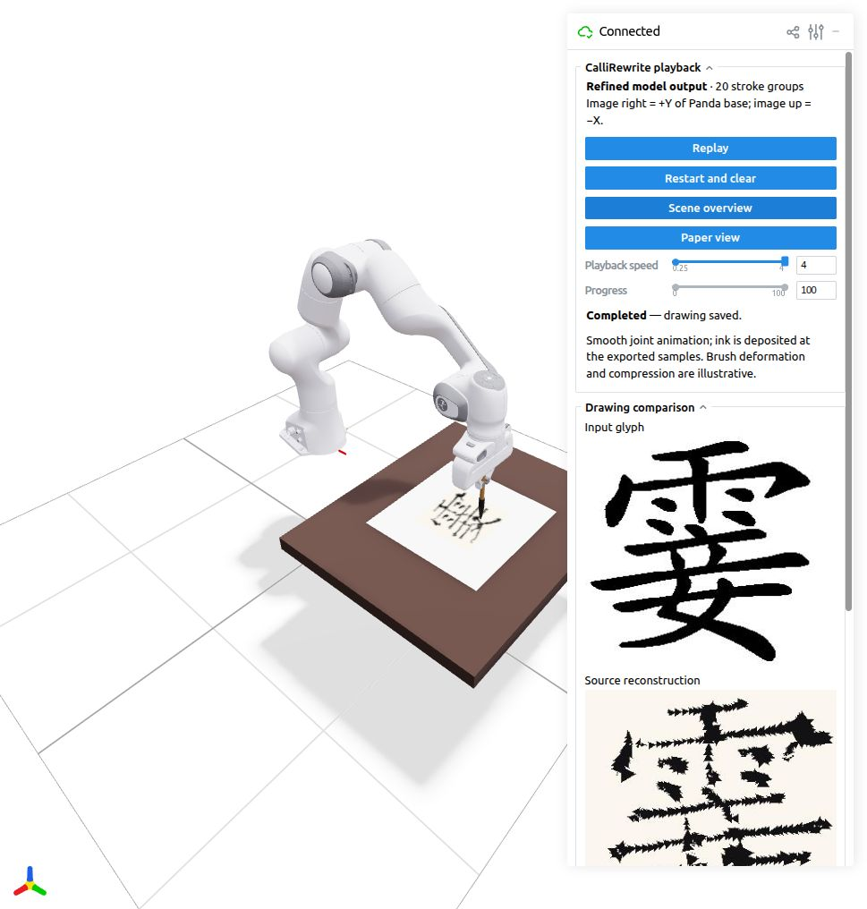
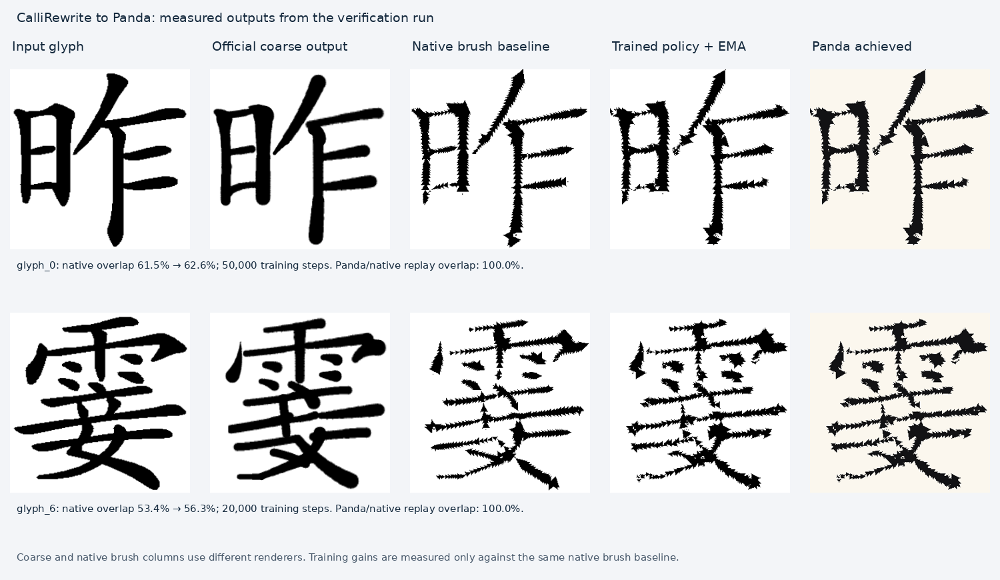

# Panda calligraphy viewer

This folder connects CalliRewrite outputs to a Franka Panda arm, a deformable brush mesh and an ink canvas in Viser. The new [`callirewrite_replay.py`](callirewrite_replay.py) accepts saved pretrained extraction results or exported SAC rollouts. The original [`calligraphy_panda_viser_sim.py`](calligraphy_panda_viser_sim.py) remains available for the hand-written `yi` and `yong` demonstrations below.

The neural models run in the separate extraction and RL environments; Viser loads their saved outputs. The official tool-aware environment is in [`../rl_finetune/`](../rl_finetune/). Its source and the original viewer were not modified for this integration.

## Verified CalliRewrite replay

**Verified on 2026-11-17:** fresh pretrained inference, bounded SAC optimization, export and Panda inverse kinematics worked for two input characters. All four coarse/refined paths passed offline replay checks; the refined image-6 example also completed live browser playback. This establishes computational integration feasibility. It does not establish full paper reproduction, generalization, physical brush fidelity or safe hardware execution.

Launch the bundled refined example with the existing environment:

```bash
cd /data/CalliRewrite
env -u PYTHONPATH -u PYTHONHOME PYTHONNOUSERSITE=1 \
  panda_calligraphy/venv/bin/python panda_calligraphy/callirewrite_replay.py \
  --input panda_calligraphy/docs/callirewrite_demo_refined.npz \
  --target panda_calligraphy/docs/callirewrite_demo_input.png \
  --output .local_setup/verification/integration/demo_replay \
  --serve --port 8080
```

Open the printed localhost URL and press **Play**. The example has 20 stroke groups and takes about 82 seconds at nominal speed. **Playback speed** accelerates the display; **Replay** repeats a finished run and **Restart and clear** resets it. The comparison panel shows the input, source reconstruction and accumulated Panda drawing. Stop the server with Ctrl+C.

### Interactive ink and brush controls

**Replay mode → Native faithful** is the default. Its ink mask uses the exact recorded footprints and preserves the released raster convention. The ink styling controls are disabled. **Ink studio** enables an artistic preview using pixel-scaled round footprints together with the exported triangles, plus adjustable opacity, color, width and a soft bleed halo. It is separate from the verified model output. Neither mode changes the saved trajectory, pose solutions, virtual compression or source contact timing.

Ink settings redraw all currently accumulated contacts immediately, including while paused or after completion. This makes comparisons at the same pose reproducible. The guide grid and fiber display are scene overlays; they are not added to the saved ink image. All settings folders can be collapsed, and the **Replay mode** selector stays outside them.

| Control | Behavior |
| --- | --- |
| **Ink opacity** / **Ink level (%)** | Multiply the displayed ink strength. Ink level is a uniform preview setting, not a reservoir simulation. |
| **Dip ink (100%)** | Restores ink level to 100% and redraws accumulated ink with the current opacity. |
| **Ink color** | Selects the preview RGB color and the displayed tuft color. |
| **Footprint scale** | Scales each round footprint and triangle about its recorded anchor; the robot path stays fixed. |
| **Paper absorbency / bleed** | Adds a Gaussian halo, with a 0–3 pixel blur scale at 300-pixel resolution. This illustrates spreading without a fluid solver. |
| **Bristle stiffness (visual)** | Changes the cubic-spine bend by an inverse gain: larger values bend less. It does not estimate force. |
| **Tuft splay (visual)** | Expands the displayed contact ellipse. It does not change ink width; use Footprint scale for that. |
| **Guide grid** / **Show fibers** / **Show arm** | Toggle scene elements for inspection; hiding the arm leaves the brush visible. |
| **Scene overview** / **Paper view** / **Brush view** | Apply repeatable overview, top-down and side-view cameras. |
| **Play one stroke** | Plays the remaining portion of the current stroke, or the next stroke, and pauses at its final contact. It does not skip the preceding lifted travel. |
| **Loop playback** | Repeats after completion and clears the displayed ink before each new run. |
| **Clear paper** | Clears ink at the current pose; only subsequent contacts draw. Earlier contacts stay excluded when settings change. |
| **Restore defaults** | Restores faithful mode and all default display settings while keeping playback progress and the current clear-paper boundary. |
| **Save preview and settings** | Writes a PNG and matching JSON under the selected output folder's `preview/` subfolder. |

A completed run also saves `preview/last_completed.png` and its settings JSON. Only a complete Native faithful run without a mid-run clear updates `viser_completed.png`; custom previews never replace `panda_achieved.png`, `panda_trajectory.npz` or `verification.json`. Starting the command itself still reruns verification in the requested output folder, so choose a new `--output` to retain previous evidence.

The display loop owns playback and settings state; UI callbacks queue commands. Preview controls operate on the fixed exported trajectory rather than issuing manual robot motion. Tests cover native pixel equality, width/bleed/color changes, clearing without rewind, one-stroke playback, immutable motion arrays and separate preview settings export:

```bash
PYTHONPATH=panda_calligraphy panda_calligraphy/venv/bin/python \
  -m unittest test_replay_studio -v
```

Use `--input panda_calligraphy/docs/callirewrite_demo_coarse.npz` to replay the pretrained coarse result. Omit `--serve` for verification and image export without a browser. These saved examples need no CUDA or neural checkpoints for playback. Existing files in `--output` are replaced, so use a new folder when retaining comparisons.

Actual completed refined replay in Viser:



### Measured results and limitations



The quality metric below is foreground intersection-over-union (IoU) against the input at the native brush canvas resolution of 300 × 300. Higher is better. All four conditions use the same released brush renderer. EMA means the exponential moving average update of the skeleton during training.

| Condition | Dataset image 0 | Dataset image 6 |
| --- | ---: | ---: |
| Fresh coarse skeleton, zero action | 61.48% | 53.37% |
| Training EMA skeleton, zero action | 63.29% | 55.88% |
| Fresh coarse skeleton, trained policy | 60.78% | 53.25% |
| Training EMA skeleton + trained policy | 62.62% | 56.31% |
| Collected training steps | 50,000 | 20,000 |
| Selected checkpoint step | 30,000 | 18,000 |
| Exported contact samples / stroke groups | 400 / 10 | 648 / 20 |

Combined refinement improves native overlap by **1.14 and 2.94 percentage points**, but the policy alone on fresh coarse geometry slightly worsens both results. Most improvement comes from skeleton updates; the policy's effect on the EMA skeleton is mixed. Training and checkpoint selection used the same glyph, with seed 42. This is a small optimization pilot, with no held-out result or convergence claim. The supplied train/test pairs also overlap, so they cannot establish generalization without constructing a separate evaluation set.

The jagged triangles visible above come from the released `Writing_Brush.draw_canvas`: polygon positions are scaled into pixels, while the normalized disk radius is passed directly to the pixel rasterizer. This apparent unit inconsistency is preserved for source-faithful verification. The smoother coarse column uses a different renderer and is **not** the baseline for the reported refinement gains. Changing the training renderer requires a separate controlled experiment and retraining. Ink studio changes only the viewer's preview and does not revise these measurements.

Verification evidence:

- **Pretrained extraction:** restored and checked the cached phase-2 and perceptual weights; fresh GPU inference took about 2.35 and 2.42 seconds including rendering. Independent exact reconstruction matched the official thresholded foreground with IoU 1.0 for both. The sampled XY/radius approximation used for coarse robot motion has 0.9586 and 0.9532 IoU against that exact raster.
- **RL export:** reloaded both selected checkpoints into fresh policies and reproduced their metrics. Exported sample footprints reconstruct the native environment mask exactly; stroke groups and sample indices are preserved.
- **Panda replay:** coarse and refined paths for both glyphs passed pose, joint-limit, nominal joint-speed, ferrule-clearance and stamp-scheduling checks. Source-to-achieved ink masks have IoU 1.0 at 300 pixels. For the refined examples, this also equals the exported native mask exactly. This measures replay fidelity, not similarity to the target glyph.
- **Between waypoints:** 23,082 interior joint-interpolation samples across four trajectories passed; the largest tip deviation from a straight Cartesian segment was 9.27 micrometres. This sampled check is not continuous collision validation.
- **Live browser:** the refined image-6 playback completed and its saved canvas matched the offline Panda raster pixel-for-pixel. Panda tests: 29 passed, two optional native-renderer tests skipped; all 21 replay tests passed in the RL environment, including those native comparisons.

The [verification record](docs/callirewrite_verification.json) contains metrics, configurations, provenance and hashes. Separate [image-0](docs/callirewrite_rl_glyph_0.png) and [image-6](docs/callirewrite_rl_glyph_6.png) figures show the ablations.

### How the integration works

```text
input glyph → official pretrained extraction → decoded quadratic strokes
            → official brush environment + bounded SAC/EMA optimization
            → saved contact samples, radii, headings and native footprints
            → paper-to-Panda mapping → tool-down pose IK + lifted travel
            → achieved forward-kinematic positions → ink raster → Viser
```

The decoder handles every extraction round, moving crop/window coordinates and pen-up commands. Extraction curves are **quadratic Bézier curves**; the illustrative deforming tuft uses a separate **cubic Bézier spine**. Width is decoded from the source renderer's radius convention, not interpreted as a measured pressure.

For normalized image column `u`, row `v`, and default glyph side `L = 0.18 m`, the new replay maps into the Panda base frame as:

```text
X = 0.55 + L × (v − 0.5)
Y =        L × (u − 0.5)
Z_nominal = 0.002 − compression
radius_m = 2 × compression
```

Thus image-right is **+Y_base**, image-up is **−X_base**, and the paper faces **+Z_base**. This prevents reflection when viewing the top surface. It supersedes the earlier proposed mapping for imported glyphs; the legacy `yi` overview farther below retains its separately labelled historical canvas convention.

The paper is 0.36 m square. A virtual radius-to-compression rule sets nominal brush height, with a maximum accepted compression of 12 mm. A 25 mm lift separates stroke groups. The solver uses the Panda URDF's complete transforms, including the fixed hand rotation, and holds the tool upright. Exported headings rotate the footprint and illustrative tuft; they do not command wrist rotation. Timing is generated from a default 25 mm/s writing speed and stretched where necessary to satisfy URDF joint-speed limits. Display speed above 1× is only a viewing acceleration.

The cubic spine and surrounding mesh illustrate contact and splay. The new replay uses an illustrative geometry model tailored to exported radii, rather than the legacy force estimate. Ink uses source sample footprints at achieved robot positions. Joint interpolation animates motion smoothly; it adds no ink stamps. Approach/lift can pass through geometric contact, but ink is gated to the exported drawing samples. There is no bristle mass solver, ink-fluid simulation, calibrated force model, robot dynamics, acceleration check or complete robot/table collision test.

### Reproduce extraction and optimization

The local environments and cached assets are already installed. The following uses a new run name to preserve the recorded evidence; change it on later runs. The extraction verifier checks archive hashes and restores missing files without downloading new weights.

```bash
cd /data/CalliRewrite
source .local_setup/activate.sh coarse
python panda_calligraphy/verify_callirewrite_extraction.py \
  --input rl_finetune/data/test_data/6.png --name repeat_glyph_6 --require-gpu

source .local_setup/activate.sh rl
python panda_calligraphy/verify_callirewrite_rl.py \
  --input-dir .local_setup/verification/integration/coarse/rl_input/repeat_glyph_6 \
  --glyph-id repeat_glyph_6 \
  --output .local_setup/verification/integration/rl/repeat_glyph_6 \
  --steps 20000 --eval-every 2000 --max-training-seconds 420 --require-gpu
python panda_calligraphy/ablate_callirewrite_rl.py \
  --run-dir .local_setup/verification/integration/rl/repeat_glyph_6 --require-gpu
python panda_calligraphy/plot_callirewrite_rl.py \
  .local_setup/verification/integration/rl/repeat_glyph_6
```

Pass the resulting `refined/trajectory.npz` to the replay command above. For the image-0 experiment use `test_data/0.png`, a distinct run name, `--steps 50000` and `--max-training-seconds 600`. Time limits can stop a run before its requested step count; inspect `report.json`.

The verification runner reuses the released environment, reward and brush raster. It builds two independent SAC critic backbones, whereas the released training entry point shares a backbone; batch size 256 and replay capacity 32,768 also differ from the official defaults. These deliberate pilot settings are recorded in each report. This is not an unchanged execution of the full paper training configuration.

Raw runs are retained under `.local_setup/verification/integration/`: `coarse/runs/`, `rl/glyph_0_extended/`, `rl/glyph_6/` and the four `panda_*` result folders. Selected locally trained policies are `best_policy.pth`, paired with `best_skeleton_rc.npy`. For checkpoint-only evaluation, use the RL verifier's `--evaluate-checkpoint` and `--evaluate-skeleton` options with a new output directory. Neural checkpoint loading belongs in the RL environment, not the viewer.

Replay outputs include `verification.json`, `panda_trajectory.npz`, `source_reconstruction.png`, `panda_achieved.png` and `comparison.png`; completed live playback adds `viser_completed.png`. `--help` lists supported replay arguments. Focused tests can be repeated with:

```bash
env -u PYTHONPATH -u PYTHONHOME PYTHONNOUSERSITE=1 \
  panda_calligraphy/venv/bin/python -m unittest discover \
  -s panda_calligraphy -p 'test_*.py'
```

No new dependencies or hardware were needed for this pilot. It used the existing RTX 3090 Ti, TensorFlow extraction environment, PyTorch RL environment and Python 3.10 viewer environment. A broader method evaluation needs distinct held-out glyphs, repeated seeds, longer training and an explicit decision about the native radius inconsistency. A physical Panda experiment would additionally need a calibrated brush/tool transform, contact model and robot safety/controller integration.

## Original scripted `yi` / `yong` scene

The following sections describe the original viewer only. It does not load extraction checkpoints or an SAC policy. Its implemented characters are `yong` (永, eight stroke groups) and `yi` (一, one stroke group). The source header also mentions 福 and 中, but they are not present in the trajectory dictionary.

### Launch with the existing environment

Run these commands in a terminal on the computer hosting the repository:

```bash
cd /data/CalliRewrite/panda_calligraphy
env -u PYTHONPATH -u PYTHONHOME PYTHONNOUSERSITE=1 \
  ./venv/bin/python -u calligraphy_panda_viser_sim.py
```

Open the HTTP URL printed by Viser, usually **http://localhost:8080**. If that port is occupied, Viser tries another port; use the URL from this run's terminal output. Successful startup prints both `URDF and meshes loaded successfully` and `[READY] Franka Panda Calligraphy Simulator is running!`.

The script has **no command-line argument parser**: there are no `--port`, `--model`, `--input` or `--help` options. Set the character and parameters in the browser. Stop the server with **Ctrl+C** in its terminal.

The command above clears inherited ROS/Conda Python paths while using this folder's Python environment. A CUDA GPU, the extraction environment and the RL environment are not required.

## What to expect

The live browser view contains the Panda robot, a dark table, Xuan paper with a red guide grid, paperweights and the brush. Orbit and zoom the 3D view to inspect the tuft and paper. Playback moves the joints through inverse kinematics; contact deforms the tuft and deposits ink on the canvas.

For a short first run:

1. Open **Calligraphy Trajectory Execution** and press **Reset Arm Pose**.
2. Select **yi**, then press **Wash Paper (Clear)** under **Tuft & Xuan Paper Physics**.
3. Press **Execute Character (Write)** and watch the arm and ink trail. The same button pauses/resumes playback and becomes **Replay Character** after completion.
4. Try **yong** for the longer eight-group trajectory. Reset the arm and clear the paper before changing characters.

## Watch the Panda draw `yi` in Viser

This is a **recording of the actual Viser browser view**, captured on October 26, 2026 with **Character = yi**, **Writing Speed = 0.2**, and **Loop Playback off**. It shows the arm lowering the brush, making contact, sweeping across the paper, and lifting after the stroke. The animation crops the 3D viewport for clarity; the simulator source was unchanged.


The four stages below are frames from that same continuous run:


| Stage | What the viewer is doing |
| --- | --- |
| **1. Approach** | IK moves the nominal tip toward the first waypoint above the paper. |
| **2. Press** | The nominal tip moves below the paper plane; the contact model bends and splays the tuft and starts the ink trail. |
| **3. Sweep** | The arm follows the built-in waypoint path while the contact tip deposits ink. |
| **4. Lift** | The final waypoint raises the nominal tip to 25 mm in world Z, leaving the stroke on the paper. |

To reproduce the sequence, follow the launch command above, select **yi**, reset the arm, clear the paper, set **Writing Speed** to **0.2**, then press **Execute Character (Write)**. Leave it running continuously to see the motion-dependent brush lag. At this speed the seven interpolated waypoint segments take roughly 16 seconds; the recording includes a short completed-state hold. Frame labels are approximate seconds from the recording start.

The built-in `yi` path sweeps mainly along **world Y** while world X stays near 0.55 m. Its apparent direction depends on the camera. The flat `XuanPaperCanvas` image maps world Y to image rows, so its raw raster appears vertical. The live recording keeps the captured camera view; the component overview below rotates the canvas 90° counterclockwise and labels its Panda-base coordinates so `yi` reads horizontally.

View the [full browser screenshot with the controls](docs/viser_yi_finished.jpg), [full-view MP4 recording](docs/viser_yi_recording.mp4), or [capture details](docs/viser_yi_capture.json). This demonstrates the hand-written trajectory player; it does not evaluate a learned CalliRewrite or SAC policy.

## How the deformable brush works

This separate diagram uses **actual meshes and bristle segments returned by `RealisticDeformableTuft`**. It compares a lifted brush, a stationary press, and a moving press. A vertical tool and motion along +X are used to make the deformation easy to see; the live Panda uses the orientation from its own forward kinematics.


- **Contact and compression:** the paper is at world Z = 2 mm. Compression is the difference between that plane and the nominal rigid tip height; contact starts when compression exceeds 0.1 mm. In contact, the actual tip is placed on the paper. The nominal tip marker below the paper is a reference, not the rendered contact position.
- **Bending and drag:** a cubic Bézier spine connects the ferrule/root to the actual tip. During horizontal motion, the contact tip lags opposite the direction of travel. The surrounding lofted mesh and individual bristle lines follow that spine; their sampled points are clamped to the paper plane.
- **Splay and stroke width:** increasing compression expands the lower tuft and the returned circular ink-footprint radius. With the default parameters, the diagram's 6 mm compression gives a **7.01 mm footprint radius**; moving at 30 mm/s adds **7.5 mm tip lag**. The orange footprint is a stamp estimate, rather than the exact mesh boundary.
- **Force estimate:** the same example returns about **1.30 N**. This is a parametric model output, not a calibrated force measurement. The stiffness slider changes this estimate; it does not change the mesh or footprint geometry.

The source computes this contact geometry afresh each tick, without integrating bristle mass or a robot force/torque solver. The canvas stamps the footprint at the actual contact tip. Its force-dependent alpha is discarded by the current RGB conversion before display, and **Paper Absorbency** changes an outline radius rather than solving fluid diffusion. See the [SVG version](docs/brush_deformation_explained.svg), [exact numerical examples](docs/brush_deformation_metrics.json), and [regeneration instructions](docs/README.md#regenerate-the-brush-diagram).

### Additional component overview


The arm/table panel uses the latest **actual Viser capture**, preserving the scene's depth and placement. The completed `yi` canvas is rotated **90° counterclockwise**: **+Y of the Panda base frame runs rightward**, and **+X runs upward**. The robot base and world frames coincide in this simulator; the paper axes are labelled in metres. This presentation change leaves the simulated trajectory and robot pose unchanged. The scene capture, completed replay and contact detail show separate moments. See the [media guide and regeneration command](docs/README.md#component-overview).

## Browser controls

| Control | Implemented behavior |
| --- | --- |
| **Character** | Selects `yong` or `yi`. Selection alone does not reset playback indices or clear the paper. |
| **Execute Character (Write)** / **Pause Writing** / **Resume Writing** | Toggles playback. |
| **Step Stroke** | Pauses, advances the stroke index and resets its interpolation position. Press Resume to play that stroke; this button does not execute an entire stroke by itself. |
| **Reset Arm Pose** | Stops playback, resets stroke indices and restores the nominal arm configuration. It does not clear ink. |
| **Writing Speed** | Changes interpolation speed from 0.2 to 3.0; default 1.0. |
| **Loop Playback** | Restarts after the last stroke and clears the canvas between loops. |
| **Tip X / Tip Y / Tip Z** | Requests a Cartesian tip position through IK while playback is paused. Negative nominal Z compresses the soft tuft against the paper. |
| **Touch Paper (Z=0)** | Despite its label, sets the requested tip Z to **0.001 m**. The paper plane is at **0.002 m**. |
| **Lift Brush (Z=35mm)** | Sets the requested tip Z to 0.035 m. |
| **panda_joint1 … panda_joint7** | Direct joint adjustment while paused, with the limits defined in the script. |
| **Bristle Stiffness** | Changes the contact-force estimate; default 1.2. |
| **Splay Factor (铺毫)** | Changes tuft expansion and contact footprint; default 1.4. |
| **Paper Absorbency** | Changes the raster bleed outline; default 0.7. |
| **Wash Paper (Clear)** | Clears ink and redraws the guide grid. |
| **Dip Ink (100%)** | Resets `ink_level`; the current drawing loop does not consume that value, so this has no visible effect. |

The contact model clamps tuft vertices to the paper plane, estimates normal force, adds motion-dependent tip lag and widens the footprint under compression. Arm motion uses position-based damped least-squares IK. This is an interactive geometric/contact demonstration; it does not run a rigid-body robot dynamics engine, torque control or robot/table collision checking.

## Inputs and outputs

The running pipeline is:

```text
built-in waypoint coordinates
  -> smooth interpolation
  -> Panda position IK and forward kinematics
  -> deformable tuft/contact estimate
  -> ink stamps on a 1024 x 1024 canvas
  -> robot, brush and paper updates in Viser
```

Only the first three values of each waypoint are used for XYZ motion. Pressing is derived from the nominal tip's height relative to the paper; the fourth waypoint value is not read by the playback loop.

There is no image/checkpoint input option and **no automatic PNG, video, trajectory or policy export**. Ink lives in memory for the current server session. The PNG in `docs/` is a documentation asset, not a file generated whenever you launch the viewer.

## Re-create the environment in a fresh checkout

The local `venv/` already exists and was used to verify startup. On another machine, use Python 3.10 and Git:

```bash
cd /path/to/CalliRewrite/panda_calligraphy
python3.10 -m venv venv
env -u PYTHONPATH -u PYTHONHOME PYTHONNOUSERSITE=1 \
  ./venv/bin/python -m pip install \
  'numpy==2.2.6' 'scipy==1.15.3' 'Pillow==12.3.0' 'viser==1.1.1' \
  'robot_descriptions==3.3.0' 'yourdfpy==0.0.60'
```

These are the principal package versions in the verified local environment; pip installs their supporting dependencies. On first startup, `robot_descriptions` downloads the Panda description and meshes into its cache, normally `~/.cache/robot_descriptions/`. This needs network access. The verified machine already had `example-robot-data/robots/panda_description/urdf/panda.urdf` cached there.

If the terminal warns that it could not load robot meshes, the brush/paper scene may still start, but the Panda arm mesh will be absent. Check the cached robot assets and the `robot_descriptions` / `yourdfpy` imports. If the page is blank or unavailable, first check the terminal for the actual port and startup errors.

## Files and verification

| File | Purpose |
| --- | --- |
| [`callirewrite_replay.py`](callirewrite_replay.py) | Saved-output adapter, verification, faithful ink raster and interactive Panda playback. |
| [`callirewrite_io.py`](callirewrite_io.py) | Decode official extraction rounds, crop coordinates, pen states and widths. |
| [`panda_replay_kinematics.py`](panda_replay_kinematics.py) | URDF-based pose IK and forward kinematics for imported outputs. |
| [`verify_callirewrite_extraction.py`](verify_callirewrite_extraction.py) | Check cached weights, run pretrained inference and validate decoding. |
| [`verify_callirewrite_rl.py`](verify_callirewrite_rl.py) | Bounded SAC training, checkpoint evaluation and native trajectory export. |
| [`ablate_callirewrite_rl.py`](ablate_callirewrite_rl.py), [`plot_callirewrite_rl.py`](plot_callirewrite_rl.py) | Separate policy/skeleton effects and plot recorded results. |
| [`verify_replay_interpolation.py`](verify_replay_interpolation.py) | Check sampled motion between saved joint waypoints. |
| [`build_verification_report.py`](build_verification_report.py) | Collect completed run evidence and bundled replay examples for this README. |
| [`calligraphy_panda_viser_sim.py`](calligraphy_panda_viser_sim.py) | Server, Panda kinematics, built-in paths, canvas and browser controls. |
| [`deformable_brush_physics.py`](deformable_brush_physics.py) | Contact-dependent tuft mesh, bristle segments, force estimate and footprint. |
| [`docs/`](docs/README.md) | Live Viser recording, `yi` stage sequence, brush diagram, provenance and media generators. |
| `venv/` | Local generated Python environment; not source documentation. |
| `calligraphy_panda_viser_toolkit.zip` | Archived toolkit; the launch command above runs the current unpacked Python files. |

Verified on **2026-10-20**: the exact launch command above reached `[READY]` on port **8080** and loaded the Panda meshes with eight actuated joints. A deterministic replay through the actual IK/brush/canvas functions produced the initial preview. The temporary documentation server was stopped after verification.

Visuals updated on **2026-10-26**: recorded the live `yi` run on the server's printed port **8081**, verified completion through **Replay Character**, and generated the separate brush diagram from three direct model evaluations. The component overview combines the latest Viser capture with a horizontal, base-frame-labelled canvas. The visual assets can be rebuilt using the scripts documented in [`docs/README.md`](docs/README.md).
