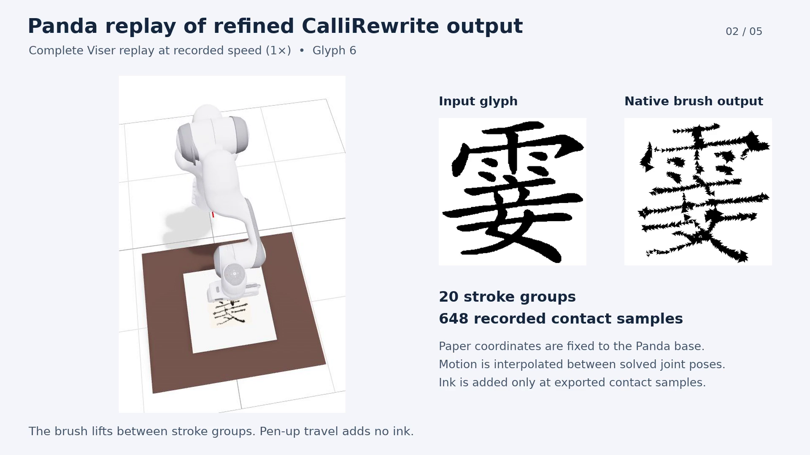

# CalliRewrite with Panda and Viser — presentation package

This local extension contains a 16-slide English PowerPoint for a 15-minute
presentation and a complete recorded demonstration. The original CalliRewrite
repository does not include this presentation or Panda integration.

## Present the slides

Open [CalliRewrite_Panda_Viser.pptx](CalliRewrite_Panda_Viser.pptx).
Each slide has speaker notes, its planned timing, and source references. The
planned 15 minutes includes the 2:30 video on slide 11. The charts are native,
editable PowerPoint charts.

In Slide Show, click the movie on slide 11. The movie is embedded in the PPTX;
it does not require a network connection. If your presentation application
does not play embedded movies, open
[CalliRewrite_Panda_Viser_demo.mp4](CalliRewrite_Panda_Viser_demo.mp4) separately.
It has readable burned-in captions and no audio, so the presenter can narrate.
The accompanying `.srt` is optional. The media structure and codec have been
checked; playback inside Microsoft PowerPoint itself has not been tested on
this Linux workstation.

| Slides | Topic | Time |
| --- | --- | --- |
| 1–5 | Purpose, coarse extraction, and tool-aware refinement | 0:00–4:25 |
| 6–10 | Environment, coordinates, deformable brush, Bézier curve, and ink | 4:25–9:05 |
| 11 | Complete recorded demonstration | 9:05–11:35 |
| 12–15 | Verification, refinement results, launch, and limitations | 11:35–14:50 |
| 16 | References | 14:50–15:00 |

[Presenter notes](presenter_notes.txt) provide a readable copy of the notes
embedded in the deck. [Video details](VIDEO_README.md) list chapter timings,
capture provenance, and the local rebuild command.

## Launch the live demonstration

From this repository on the configured machine:

```bash
cd /data/CalliRewrite
bash panda_calligraphy/presentation/launch_demo.sh
```

The launcher uses the existing `panda_calligraphy/venv`, verifies the saved
refined trajectory, and starts Viser on port 8084. Open the printed URL
(normally <http://localhost:8084/>) and press **Play**. Use **Replay** to repeat,
**Restart and clear** to reset, **Scene overview** to see the arm and table,
and **Paper view** to inspect the drawing. Stop the server with Ctrl+C in the
terminal. To choose a different port:

```bash
bash panda_calligraphy/presentation/launch_demo.sh --port 8085
```

The bundled replay needs no GPU. For model extraction, other characters, or
refinement training, follow the [Panda integration README](../README.md).
The launch script accepts additional replay options after its defaults.

## Expected result

The Panda follows all 20 decoded stroke groups of the bundled example,
lifts between groups, and accumulates ink on the paper. The recorded main
trajectory lasts about 82 seconds at speed 1×. The final ink intentionally
preserves the released renderer's jagged footprints.



The measured 100% mask agreement means that the robot replay preserves the
exported native ink at 300 × 300 pixels. It does not mean that the drawing
matches the target character perfectly. The current tuft is an illustrative
geometric deformation; physical force, material behavior, dynamics and
real-robot drawing accuracy remain unvalidated. The video labels the earlier
scripted **yi** chapter separately because it is not a CalliRewrite prediction.

Primary references: [official repository](https://github.com/LoYuXr/CalliRewrite),
[paper](https://arxiv.org/html/2405.15776v1), [Viser](https://viser.studio/main/),
and [cubic Bézier definition](https://www.w3.org/TR/SVG/paths.html#PathDataCubicBezierCommands).
Local measurements are in [the verification report](../docs/callirewrite_verification.json).
