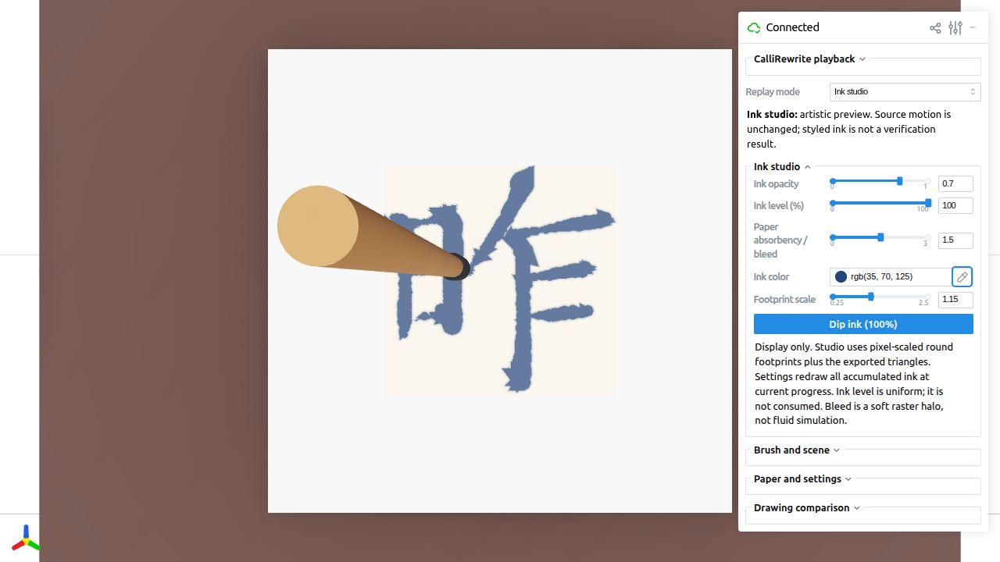
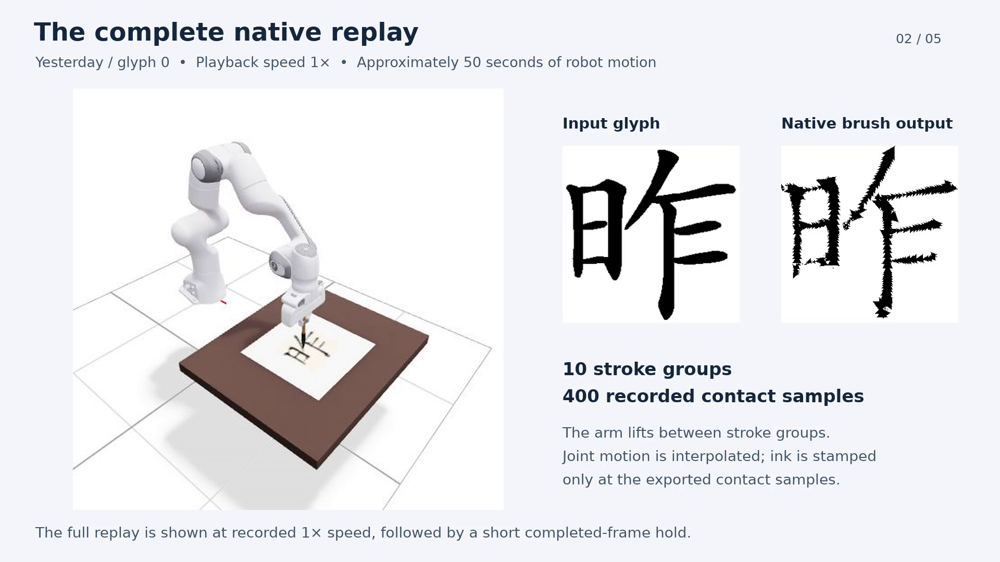

# Version 2 — Yesterday and adjustable CalliRewrite replay

This revision uses **昨 (zuó, “yesterday”)**, dataset image 0, for the complete
recorded example. The previous PowerPoint, video, captions, poster and launch
script remain unchanged.

Open [the v2 PowerPoint](CalliRewrite_Panda_Viser_v2.pptx) for the 15-minute
presentation. It contains timed speaker notes, editable charts and the complete
2:30 demonstration embedded on slide 11. Click the movie in Slide Show to play.
Use [the standalone v2 video](CalliRewrite_Panda_Viser_demo_v2.mp4) if your viewer
does not support embedded playback. The movie is silent with burned-in captions
for live narration. [Presenter notes](presenter_notes_v2.txt) are also provided
as a readable copy of the notes embedded in the slides. Native Microsoft PowerPoint playback has not been tested
on this Linux workstation.

## Start the interactive viewer

From the configured repository:

```bash
cd /data/CalliRewrite
bash panda_calligraphy/presentation/launch_demo_v2.sh
```

Open the printed address (normally <http://localhost:8086/>). Press **Play**.
This uses the existing viewer environment and saved refined Yesterday trajectory;
no GPU or model training is required for replay. To choose a different port:

```bash
bash panda_calligraphy/presentation/launch_demo_v2.sh --port 8087
```

The viewer has two ink modes:

- **Native faithful** preserves the released CalliRewrite footprint convention.
  Use this mode for the comparison with the exported native ink.
- **Ink studio** lets you adjust the displayed ink and paper. These are visual
  experiments applied to the saved trajectory; their ink appearance is separate
  from the native verification metric.

Ink setting changes redraw the accumulated part of the drawing. Brush bending
and splay settings control illustrative geometry. The saved path and solved
Panda poses remain the basis of playback. See the [integration guide](../README.md)
for all controls and for using another character.



## Video chapters

| Time | Content |
| --- | --- |
| 0:00–0:06 | Yesterday input and workflow |
| 0:06–1:00 | Complete refined trajectory at recorded speed, 1× |
| 1:00–1:35 | Interactive ink and display controls |
| 1:35–2:00 | Deformable brush close-up |
| 2:00–2:30 | Native replay result and limitations |

The main trajectory lasts about 49.98 seconds, contains 10 decoded stroke groups
and deposits 400 exported contact samples. “Stroke groups” refers to model
segmentation, rather than a canonical teaching stroke count.



The native-mode mask agreement tests replay fidelity at 300 × 300 pixels. The
adjustable ink display and geometric tuft do not establish physical brush,
fluid, or real-robot drawing accuracy. The published method and the local
integration are distinguished throughout the slides.

Sources: [CalliRewrite paper](https://arxiv.org/html/2405.15776v1),
[official repository](https://github.com/LoYuXr/CalliRewrite),
[Viser](https://viser.studio/main/), and
[local verification report](../docs/callirewrite_verification.json).
